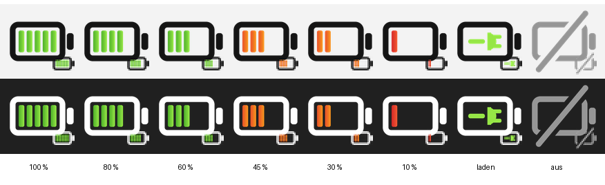

# MausAkku

Kleine Windows-App, die den Akkustand der **Glorious Model D 2 Wireless** als Symbol im Infobereich der Taskleiste anzeigt – ohne dass Glorious CORE laufen muss.



## Was die App macht

| Zustand | Symbol |
|---|---|
| Akku ab 50 % | grüne Balken (5 Balken = 100 %) |
| Akku 15–49 % | orange Balken |
| Akku unter 15 % | rote Balken |
| Maus hängt am USB-Kabel (lädt) | Akku mit Stromstecker |
| Maus aus / Ruhemodus / Empfänger fehlt | grauer, durchgestrichener Akku |

* Mauszeiger auf das Symbol: Tooltip mit Akkustand in %.
* Linksklick: kurze Statusmeldung.
* Bei **15 %** (einstellbar) kommt eine Windows-Meldung „Maus-Akku schwach – die Maus gehört zum Laden angesteckt“, bei **5 %** eine zweite Warnung.
* Das Symbol passt sich automatisch an helle oder dunkle Taskleiste an.

**Rechtsklick-Menü:**
* Jetzt aktualisieren
* Warnen bei Akkustand (10 / 15 / 20 / 25 / 30 %)
* Abfrage-Intervall (30 s bis 5 min)
* Warnmeldungen anzeigen (an/aus)
* **Mit Windows starten (Autostart)** – Häkchen setzen = in den Autostart, nochmal klicken = wieder raus
* Diagnose-Log öffnen
* Beenden

## EXE über GitHub bauen lassen (kein Visual Studio nötig)

1. Auf github.com ein neues Repository anlegen, z. B. `MausAkku` (privat geht auch).
2. **Add file → Upload files**, den kompletten Inhalt dieses Ordners hineinziehen (inkl. des Ordners `.github` – falls der Browser versteckte Ordner nicht zeigt: Datei `.github/workflows/build.yml` über **Add file → Create new file** anlegen und den Inhalt hineinkopieren) und **Commit changes**.
3. Reiter **Actions** öffnen → der Lauf „Build“ startet automatisch (ca. 2–3 Minuten).
4. Lauf anklicken → unten bei **Artifacts** „MausAkku“ herunterladen → ZIP entpacken → `MausAkku.exe`.

Optional: Ein Tag `v1.0.0` anlegen (Releases → Draft a new release → Tag `v1.0.0`), dann liegt die EXE dauerhaft unter **Releases**.

Die EXE an einen festen Ort legen (z. B. `C:\Tools\MausAkku\`), **dann** starten und per Rechtsklick „Mit Windows starten“ aktivieren. Wird die EXE später verschoben, Autostart einmal aus- und wieder einschalten.

## Hinweise

* Funktioniert über den **2,4-GHz-Empfänger** (USB-ID 093A:824D) und per **Kabel** (093A:824A). Im **Bluetooth**-Modus gibt es keine Anzeige.
* Glorious veröffentlicht das Protokoll nicht. Die App nutzt Erkenntnisse aus dem Open-Source-Projekt [GloriousBatteryMonitor-Go](https://github.com/Cabbarot/GloriousBatteryMonitor-Go): Der Empfänger meldet den Akku als Datenpaket `06 FB <Prozent> …`.
* Während die Maus am Kabel hängt, zeigt die App das Stecker-Symbol. Ob dabei auch der Prozentwert kommt, hängt von der Firmware ab.
* Schläft die Maus (längere Zeit nicht bewegt), erscheint nach ein paar Minuten das graue Symbol, im Tooltip steht der letzte Wert.
* Falls nichts angezeigt wird: Rechtsklick → **Diagnose-Log öffnen**. Dort stehen die gefundenen Schnittstellen und die empfangenen Rohdaten – damit lässt sich das gezielt anpassen.

## Symbole neu erzeugen

Die Symbole in `Icons/` werden mit `tools/make_icons.py` (Python + Pillow) erzeugt. Farben und Formen lassen sich dort anpassen:

```
pip install pillow
python tools/make_icons.py
```
